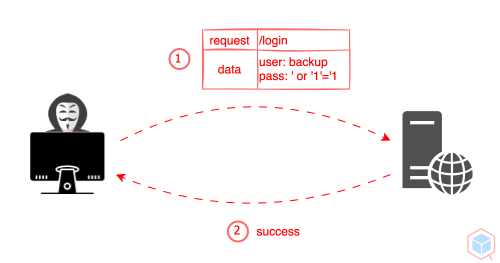
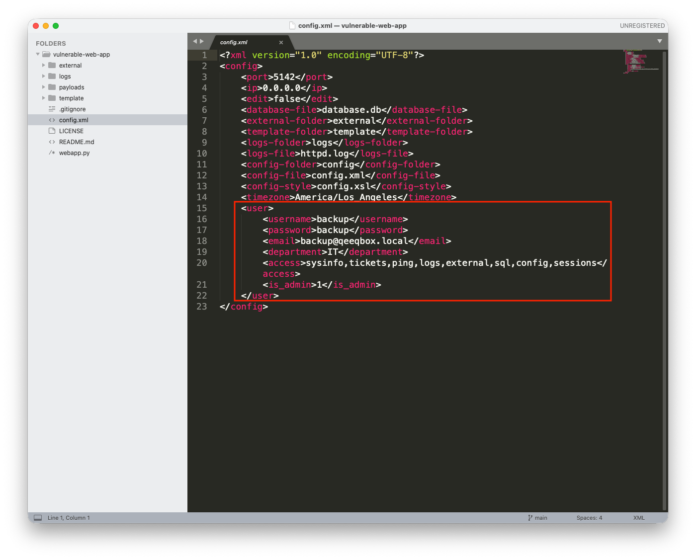
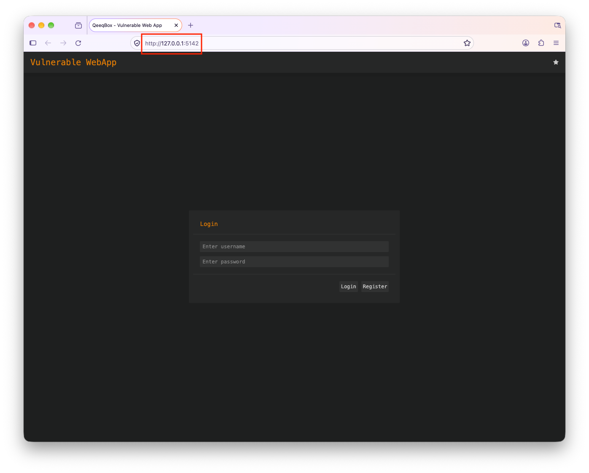
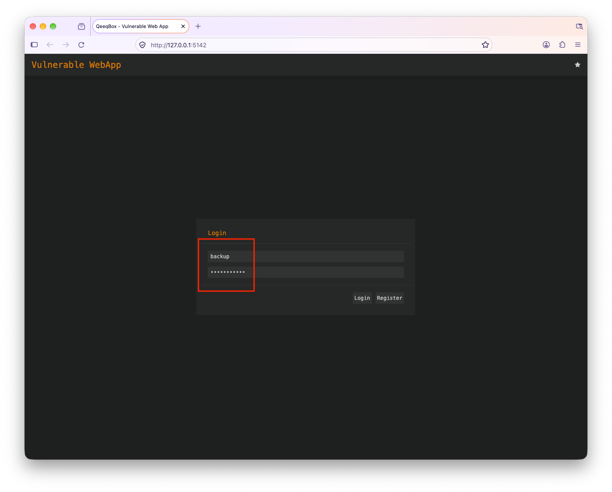
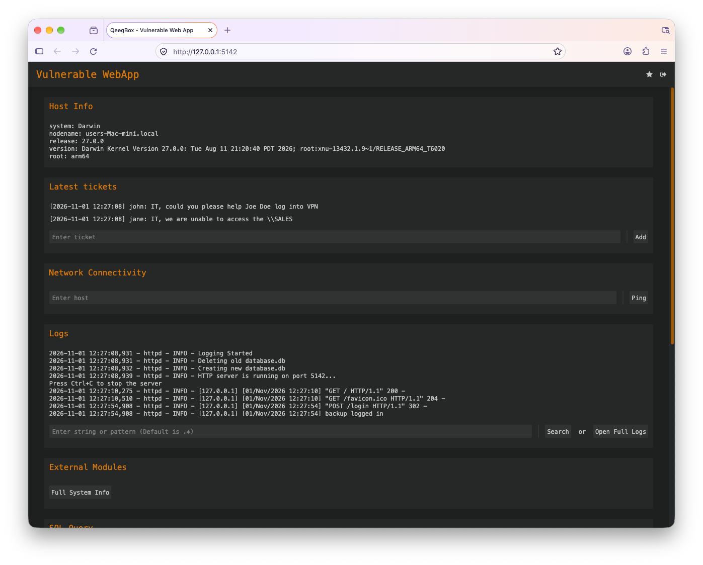

<p align="center"> </p>

XPath Injection is a security vulnerability that occurs when an application constructs XPath queries using untrusted input without adequate protection. This oversight allows attackers to manipulate the query logic, potentially granting unauthorized access to XML data or sensitive information.

XPath (XML Path Language) is utilized to navigate and query XML documents. For instance, when applications dynamically generate XPath expressions based on user-supplied input, attackers can inject malicious syntax to modify how the query is evaluated.

## How XPath Injection Works
1. Untrusted User Input: An application accepts input controlled by the user, such as a username, password, or search term, and incorporates it into an XPath query.
2. Unsafe XPath Construction: The application inserts user input directly into an XPath expression without properly separating it from the query syntax.
3. Malicious XPath Input: An attacker submits specially crafted input containing XPath operators or expressions designed to alter the original query's conditions or logic.
4. Execution of the Modified XPath Query: The application evaluates the modified XPath expression, which may return unauthorized XML data, bypass authentication checks, or produce unintended results.

## Impact of XPath Injection
- Authentication Bypass: An attacker may manipulate authentication queries to bypass username and password verification.
- Unauthorized Data Access: An attacker may retrieve XML data that the application was not intended to expose.
- Sensitive Information Disclosure: Confidential information stored in XML documents, such as user records, credentials, or application data, may be exposed.
- Authorization Bypass: If an application relies on XPath query results to enforce access controls, an attacker could manipulate those queries to gain access to unauthorized records or resources.
- Data Enumeration: An attacker can use crafted queries and observe the application’s responses or behavior to infer the structure and contents of XML documents.
- Application Logic Manipulation: Modified XPath expressions can alter filtering conditions or query results, affecting the application's functionality.

## Mitigating XPath Injection
- Avoid Dynamic XPath Construction: Do not concatenate untrusted user input directly into XPath expressions, especially in query strings.
- Use Variable-Based Queries: When supported by the XPath library, utilize variable binding to safely incorporate user-supplied values instead of inserting them directly into query strings.
- Validate User Input: Implement appropriate input validation, including length restrictions and expected data types, as an additional security layer.
- Use Safe XPath APIs: Prefer XML libraries and query interfaces that safely handle user-controlled values by avoiding direct string insertion.
- Apply the Principle of Least Privilege: Restrict access to XML documents and data according to the application's actual requirements.
- Implement Proper Authorization: Enforce access controls independently of XPath query results to prevent unauthorized access to sensitive records.
- Limit Error Information: Prevent the exposure of detailed XPath parser errors or internal query information that could aid attackers in understanding the application's XML structure.
- Keep XML Libraries Updated: Use supported versions of XML processing libraries and regularly apply security updates to reduce vulnerability to known issues.
- Perform Security Testing: Conduct code reviews and security testing to identify unsafe XPath construction and ensure that user input cannot alter the intended query logic.

## XML Injection Example
Clone this current repo recursively
```sh
git clone --recurse-submodules https://github.com/qeeqbox/xpath-injection
```
Run the webapp using Python
```sh
python3 xpath-injection/vulnerable-web-app/webapp.py
```
Enable the edit option in the config.xml
<p align="center"> </p>
Open the webapp in your browser 127.0.0.1:5142
<p align="center"> </p>
Use the backup as username and ' or '1'='1 as password to login
<p align="center"> </p>
You are logged in with the ' or '1'='1 payload
<p align="center"> </p>

## Code
When a user logs in using a username and password in a POST request to the login route, the credentials are sent to the check_creds() function
```py
if parsed_url.path == "/login" and "username" in post_request_data and "password" in post_request_data:
    ret = self.check_creds(post_request_data['username'][0],post_request_data['password'][0])
    if isinstance(ret, list) and ret[0] == "valid":
        self.send_content(302, self.gen_cookie(ret[1],60*15,query_request_data)+[('Location', URL)], None)
        self.log_message("%s logged in" % post_request_data['username'][0])
        return
```
The check_creds() function checks if a user exists in the XML config file or SQLite database, the XPath query is constructed improperly
```py
def check_creds(self, username, password):
    try:
        from lxml import etree
        root = etree.parse(CONFIG_FILE).getroot()
        valid_username = root.xpath( f"//user[username='{username}']")
        if valid_username:
            valid_password = root.xpath( f"//user[username='{username}' and password='{password}']")
            if valid_password:
                valid_password = (0, username, None, root.xpath("//email/text()")[0], root.xpath("//department/text()")[0], root.xpath("//access/text()")[0], root.xpath("//is_admin/text()")[0], None)
                return ["valid",valid_password]
            else:
                return ["password",valid_username]

        with connect(DATABASE, isolation_level=None, check_same_thread=False) as connection:
            cursor = connection.cursor()
            valid_username = cursor.execute("SELECT * FROM users WHERE username='%s'" % (username)).fetchone()
            if valid_username:
                valid_password = cursor.execute("SELECT * FROM users WHERE username='%s' AND hash='%s'" % (username,sha512(password.encode("utf-8")+SALT).hexdigest())).fetchone()
                if valid_password:
                    return ["valid",valid_password]
                else:
                    return ["password",valid_username]
            else:
                return ["username", username]
    except Exception as e:
        return ["error",str(e).encode("utf-8")] 
```
